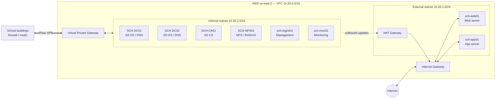

# AWS Cloud Infrastructure for a Small Charter School

Terraform code for a small cloud network for a charter school in Ann Arbor, Michigan (about 20 staff and 150–200 students). It implements the companion design document *AWS Cloud Infrastructure Design for a Small Charter School* (IT356 Assignment 3).

## What this deploys

| Component | Configuration |
|---|---|
| Cloud provider | Amazon Web Services |
| Region | US East (Ohio), `us-east-2`, the closest AWS region to Ann Arbor |
| VPC | `10.20.0.0/16` |
| External subnet | `10.20.1.0/24`, routed to the internet through an Internet Gateway |
| Internal subnet | `10.20.2.0/24`, no public IPs; outbound-only internet through an optional NAT Gateway |
| School connectivity | AWS Site-to-Site IPsec VPN (virtual private gateway and customer gateway) |
| Windows servers | 4 servers in the internal subnet, each 4 vCPU / 8 GiB (`c6i.xlarge`) |
| Linux servers | 4 servers (2 external, 2 internal), each 2 vCPU / 4 GiB (`t3.medium`) |
| Logging | VPC Flow Logs sent to CloudWatch Logs |

### Server inventory

| Host | Role | OS | Subnet | Private IP | Public IP |
|---|---|---|---|---|---|
| SCH-DC01 | Primary Domain Controller (AD DS, DNS) | Windows Server 2022 | Internal | 10.20.2.10 | None |
| SCH-DC02 | Secondary Domain Controller (AD DS, DNS) | Windows Server 2022 | Internal | 10.20.2.11 | None |
| SCH-CA01 | Microsoft Certificate Authority (AD CS) | Windows Server 2022 | Internal | 10.20.2.20 | None |
| SCH-NPS01 | Network Policy Server (RADIUS) | Windows Server 2022 | Internal | 10.20.2.30 | None |
| sch-web01 | External web server | Ubuntu 24.04 LTS | External | 10.20.1.10 | Elastic IP |
| sch-app01 | External application server | Ubuntu 24.04 LTS | External | 10.20.1.11 | Elastic IP |
| sch-mgmt01 | Internal management server | Ubuntu 24.04 LTS | Internal | 10.20.2.40 | None |
| sch-mon01 | Internal monitoring and logging | Ubuntu 24.04 LTS | Internal | 10.20.2.50 | None |

Storage uses the default root volume size for each AMI, encrypted at rest.

### Architecture



## Repository layout

| File | Purpose |
|---|---|
| `providers.tf` | Terraform and AWS provider versions, deployment region, default tags |
| `variables.tf` | All configurable values (CIDRs, instance types, AMIs, VPN peer) |
| `main.tf` | VPC, subnets, gateways, routes, VPN, security groups, EC2 instances, flow logs |
| `outputs.tf` | VPC and subnet IDs, server IPs, VPN tunnel endpoints |
| `terraform.tfvars.example` | Example variable values with no sensitive information |

## Security design

- **Network separation:** public-facing Linux servers sit in the external subnet. Every Windows server and both internal Linux servers sit in the internal subnet with no public IP.
- **External hosts cannot reach the domain:** internal security groups accept traffic only from the internal subnet and the school network. The external subnet is excluded on purpose.
- **Role-based security groups**, each opening only the ports its role needs:

  | Security group | Allowed inbound |
  |---|---|
  | External web | 80/443 from anywhere; SSH from admin sources |
  | External app | 443 from anywhere; SSH from admin sources |
  | Domain controllers | DNS, Kerberos, LDAP/LDAPS, SMB, Global Catalog, RPC, NTP from internal sources; all traffic between DCs |
  | Certificate authority | RPC enrollment, web enrollment, CRL/AIA from internal sources |
  | NPS | RADIUS 1812/1813 UDP from internal sources |
  | Windows admin | RDP from admin sources; RDP/WinRM from the management server |
  | Management | SSH from admin sources |
  | Monitoring | Syslog 514 from the VPC and school; HTTPS dashboard and SSH from admin sources |

- **No open SSH or RDP to the internet:** administrative ports accept traffic only from the school network (over the VPN) and any extra ranges in `admin_cidr_blocks`.
- **Encryption:** both VPN tunnels are limited to IKEv2 with AES-256, SHA-256, and DH group 14. EBS root volumes are encrypted.
- **IMDSv2 required** on every instance to protect instance credentials.
- **Visibility:** VPC Flow Logs record all traffic to CloudWatch Logs, and `sch-mon01` receives syslog from servers and network equipment.

## Prerequisites

1. **Terraform 1.5 or later.** Download it from <https://developer.hashicorp.com/terraform/install> or install it with `winget install Hashicorp.Terraform`.
2. **AWS CLI**, configured with credentials that can create VPC, EC2, IAM, and CloudWatch resources (`aws configure`).
3. **An EC2 key pair in `us-east-2`.** You can create one with:
   ```bash
   aws ec2 create-key-pair --region us-east-2 --key-name charter-school-admin \
     --query KeyMaterial --output text > charter-school-admin.pem
   ```
4. **School network details:**
   - the public IP of the school firewall
   - the school's internal address range, which must not overlap `10.20.0.0/16`

## Deployment

```bash
# 1. Clone the repository
git clone <this-repository-url>
cd charter-school-aws-terraform

# 2. Create your variable file and fill in the required values
cp terraform.tfvars.example terraform.tfvars

# 3. Download the AWS provider
terraform init

# 4. Format and check the configuration
terraform fmt
terraform validate

# 5. Review exactly what will be created (about 40 resources)
terraform plan -out=school.tfplan

# 6. Deploy
terraform apply school.tfplan

# 7. Show deployment details at any time
terraform output
```

To remove everything, run `terraform destroy`.

## Post-deployment configuration

Terraform builds the infrastructure and installs each role's software on first boot. The steps below finish configuring the services.

1. **Configure the VPN on the school firewall:**
   - In the AWS console, open **VPC → Site-to-Site VPN connections**.
   - Select the connection and choose **Download configuration** for your firewall vendor.
   - Configure **both** tunnels from that file. The tunnel endpoints are also shown in `terraform output vpn_tunnel_endpoints`.
   - Add a route on the school firewall for `10.20.0.0/16` through the tunnels.
2. **Get the Windows Administrator passwords:** in the EC2 console, choose **Connect → RDP client → Get password**, or run `aws ec2 get-password-data --instance-id <id> --priv-launch-key charter-school-admin.pem`. Then connect over the VPN with RDP.
3. **Promote SCH-DC01:** create the forest, for example `Install-ADDSForest -DomainName school.local`. Create organizational units for Staff, Students, and Servers, and apply Group Policy for password and security settings.
4. **Point the network at the DCs:**
   - Set the DNS servers on the internal servers and school DHCP scopes to `10.20.2.10` and `10.20.2.11`.
   - Optionally, create an `aws_vpc_dhcp_options` set pointing at the DCs.
5. **Promote SCH-DC02:** join it to the domain and run `Install-ADDSDomainController -DomainName school.local -InstallDns`. Check replication with `repadmin /replsummary`.
6. **Set up SCH-CA01:** join it to the domain and run `Install-AdcsCertificationAuthority -CAType EnterpriseRootCA`. Then publish certificate templates.
7. **Set up SCH-NPS01:**
   - Join it to the domain.
   - Register it in Active Directory with `netsh ras add registeredserver`.
   - Add the school switches and wireless controllers as RADIUS clients, then create network policies that use AD groups.
8. **Set up the Linux servers:**
   - Configure the web content and HTTPS certificates on `sch-web01` and `sch-app01`.
   - Enable the rsyslog UDP/TCP listeners on `sch-mon01`.
   - Forward logs from the other servers to `10.20.2.50`.

## Verification checklist

- [ ] `terraform output servers` shows 8 instances, and each is in the subnet listed in the inventory above
- [ ] Only `sch-web01` and `sch-app01` have public IPs
- [ ] Both VPN tunnels show **UP** in the AWS console
- [ ] A school computer can ping and resolve DNS against `10.20.2.10` and `10.20.2.11`
- [ ] `repadmin /replsummary` reports no replication errors
- [ ] A domain computer can enroll for a certificate from SCH-CA01
- [ ] A test wireless login authenticates through NPS (check the NPS event log)
- [ ] `https://<web elastic IP>` loads from the internet, and SSH to that IP from the internet is refused
- [ ] Flow log records appear in CloudWatch Logs under `/vpc/charter-school-prod/flow-logs`

## Cost notes

The largest costs are the four Windows instances (including Windows licensing), the NAT Gateway, and the VPN connection. To reduce cost:

- set `enable_nat_gateway = false` if internal servers can get updates another way
- stop non-critical instances outside school hours
- consider Savings Plans once the environment is stable
